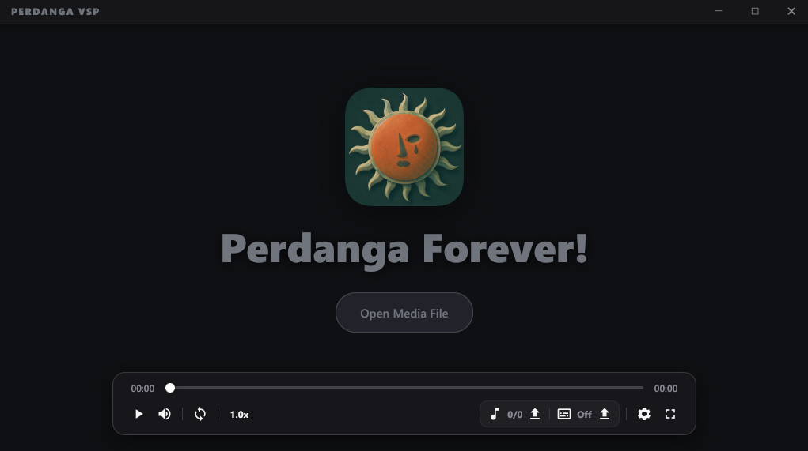
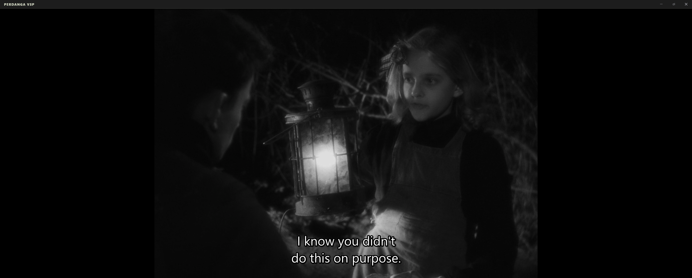
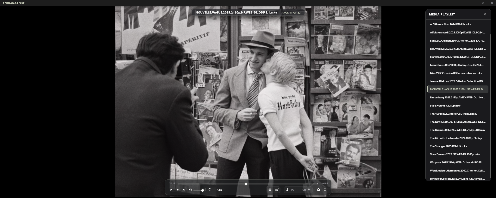
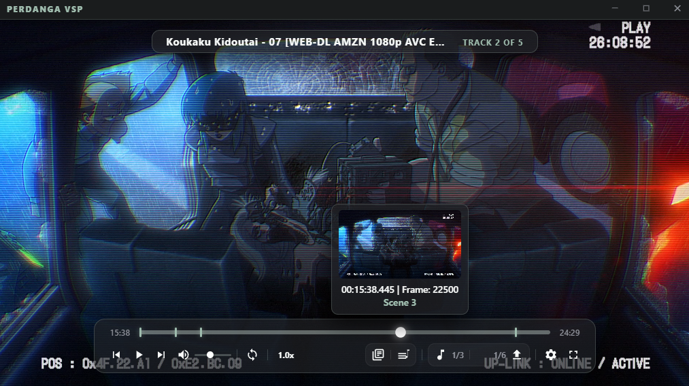
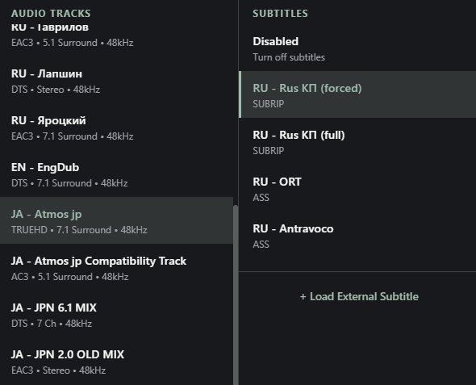

<div align="center">

 

# Perdanga VSP 

**Perdanga VSP - a native C++ media player built with libmpv and D3D11 hardware rendering.**

</div>

<p align="center">
  
</p>

<p align="center">
  <b>Media Playlist & Timeline Preview</b><br>
  
</p>

| Video Frame Preview | Audio & Subtitles |
| :---: | :---: |
|  |  |

---

## Features

- **Direct3D 11 Native Output:** Video rendered directly into the native Win32 window via `libmpv` with hardware VSync synchronization (`d3d11-sync-interval=1`) and `video-sync=display-resample`.
- **Ultralight 2.0 WebCore Engine:** Lightweight, high-performance HTML5/CSS3 user interface powered by pure in-process WebKit, reducing RAM consumption to ~65–100 MB and spawning zero background Chromium helper processes.
- **Packaged In-Memory UI (`ui.pak`):** All HTML, CSS, JavaScript, and icon resources are compiled into a single binary archive and loaded directly via a custom virtual file system, eliminating loose text files in the installation directory.
- **YouTube-Style Discrete Storyboard Preview:** Hovering over the timeline provides millisecond-precise timestamps, frame numbers, chapter badges, and adaptive aspect-ratio frame previews with discrete spatial quantization, zero-flicker double-buffered caching, and lookahead prefetching.
- **Heavy 4K / Remux Playback Engine:** Optimized background demuxing buffers and decoding pipelines handle 50GB+ ultra-high-bitrate HEVC and Dolby Vision media smoothly with zero playback stutter during rapid scrubbing.
- **Transparent Glass UI:** Modern glassmorphism aesthetic with subtle blur effects, curated accent color palette with native Windows color picker integration, and borderless window snapping.
- **Single-Instance Win32 Architecture:** Opening files from File Explorer immediately routes them into the active running instance with no duplicate processes.
- **Full Subtitle & Audio Engine:** Switch embedded audio and subtitle tracks on the fly, adjust delay (`-0.1s / +0.1s`), customize vertical positioning, and load external `.srt`/`.vtt`/`.ass`/`.mka` files via file dialog or drag-and-drop.

---

## Supported Formats

- **Video Containers:** MP4, MKV, WebM, AVI, MOV, TS, M2TS, FLV, WMV, VOB, and more.
- **Video Codecs:** AV1, HEVC/H.265, H.264/AVC, VP9, VP8, MPEG-2, VC-1, ProRes, etc.
- **Audio Formats:** MP3, FLAC, WAV, AAC, OGG, Opus, M4A, AC3, E-AC3, DTS, ALAC.
- **Subtitles:** ASS/SSA, SRT, WebVTT, PGS, VobSub.

---

## ⌨️ Hotkeys & Controls

| Shortcut | Action |
| :--- | :--- |
| `Space` | Play / Pause |
| `Double Click` | Toggle Fullscreen |
| `<` / `>` (`,`, `.`) | Adjust Playback Speed (-/+ 0.05x) |
| `Left` / `Right` | Smooth Seek -/+ 5 Seconds (Accelerates on hold) |
| `Arrow Up` / `Down`, `+` / `-`, `0` / `9` | Adjust Volume -/+ 5% (up to 150%) |
| `M` | Mute / Unmute Volume |
| `Shift` + `Left` / `Right` | Skip to Previous / Next Chapter |
| `PgUp` / `PgDn` | Previous / Next File in Playlist |
| `L` | Toggle Playlist Menu |
| `C` | Toggle Chapters Menu |
| `S` | Take Instant Screenshot (Saved to `Pictures/Perdanga VSP`) |
| `Ctrl` + `+` / `-` | Subtitle Size Scaling |
| `Shift` + `+` / `-` | Subtitle Vertical Position |
| `G` / `H` | Subtitle Sync Timing (-/+ 0.1s) |
| `Mouse Wheel` | Adjust Volume (video/icon), Playback Speed, or Cycle Tracks |
| `Right Click` | Quick Track & Subtitle Selection Menu |
| `Escape` | Exit Fullscreen or Close Active Modal / Panel |

---

## Technology Stack

- **Core Backend:** C++20 (MSVC), Windows API (Win32), OLE / Shell APIs, Direct3D 11, DWM.
- **Playback & Demuxing:** `libmpv` (C API, Direct3D 11, FFmpeg-based decoders).
- **UI Engine:** Ultralight 2.0 WebCore (WebKit-based embeddable HTML/CSS renderer).
- **Frontend Assets:** HTML5, CSS3, ES6+ JavaScript compiled into binary `ui.pak`.
- **Build System:** CMake 3.20+ with NMake Makefiles.
- **Packaging:** Inno Setup 6 (LZMA2/max compression).

---

## 📂 Project Structure

```text
Perdanga VSP/
├── CMakeLists.txt          # Root CMake build configuration
├── build.bat               # Automated build & package script
├── installer.iss           # Inno Setup installation script & registry associations
│
├── scripts/                # Build & Packaging Utilities
│   └── pack_ui.ps1         # Compiles ui/ assets into binary resources/ui.pak
│
├── src/                    # C++ Native Core
│   ├── main.cpp            # Win32 host, Ultralight WebCore glue, PakFileSystem, OLE drag & drop
│   ├── mpv_player.h        # libmpv thread-safe wrapper interface
│   ├── mpv_player.cpp      # libmpv engine setup, D3D11 options, IPC event pump, background thumbnailer
│   └── utils.h             # Unicode converters, path resolution, playlist parser
│
├── ui/                     # Web Frontend Source Files (Packed into ui.pak during build)
│   ├── index.html          # Application layout and modals
│   ├── styles.css          # Glassmorphism styling and animation
│   ├── renderer.js         # UI logic, timeline controller, and state management
│   ├── thumbnails.js       # Discrete storyboard preview scheduler & preloaded canvas cache
│   ├── timeline.js         # Timeline seekbar controller & chapter marks
│   ├── playlist.js         # Media playlist controller & queue
│   ├── tracks.js           # Subtitle & audio track manager
│   ├── settings.js         # Preference panels, theme & accent color manager
│   ├── hotkeys.js          # Global keyboard shortcut listeners
│   ├── bridge.js           # Bidirectional IPC bridge (Ultralight <-> C++)
│   ├── osd.js              # On-screen display notifications
│   ├── utils.js            # Frontend utility functions
│   └── ico/                # Application & media icons
│
├── ultralight/             # Ultralight 2.0 SDK
│   ├── include/            # C++ headers (AppCore, Ultralight, WebCore)
│   ├── lib/                # Import libraries (AppCore.lib, Ultralight.lib, WebCore.lib)
│   ├── bin/                # Dynamic runtime libraries (.dll)
│   └── resources/          # WebCore data files (cacert.pem, icudt67l.dat)
│
└── libmpv/                 # libmpv SDK
    ├── include/mpv/        # C header files (client.h, etc.)
    ├── lib/                # Import library (mpv.lib)
    └── mpv.dll             # Dynamic runtime library
```

---

### Prerequisites

1. **Windows 10 / 11 (64-bit)**
2. **Visual Studio 2022 / 2026** (or Build Tools) with the **"Desktop development with C++"** workload.
3. **CMake 3.20 or newer**.
4. **Inno Setup 6** (Required for building the installer).

---

### Step-by-Step Build Guide

#### 1. Development SDKs Setup

Ensure the `libmpv` and `ultralight` folders are present in the project root with the required headers and libraries:

```text
libmpv/
├── include/mpv/client.h
├── lib/mpv.lib
└── mpv.dll

ultralight/
├── include/ (AppCore/, Ultralight/, JavaScriptCore/)
├── lib/ (AppCore.lib, Ultralight.lib, UltralightCore.lib, WebCore.lib)
├── bin/ (*.dll)
└── resources/ (cacert.pem, icudt67l.dat)
```

#### 2. 📦 Compile the Application and Installer
1. Open **x64 Native Tools Command Prompt for VS**.
2. Navigate to the project root directory:
   ```cmd
   cd "C:\Path\To\Perdanga VSP"
   ```
3. Run the automated build script:
   ```cmd
   build.bat
   ```
*The compiled executable will be located at `build\PerdangaVSP.exe`, and the complete installer will be generated at `dist\PerdangaVSP_Setup.exe`.*

---

<br>

<div align="center">
  
   <br><br>
  <h2>Perdanga Forever!</h2>
</div>
